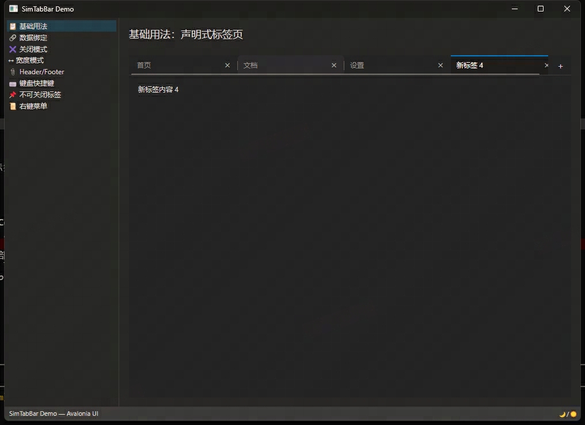

# SimTabBar

类似 VS Code 的标签页 Avalonia 控件库。



## 功能特性

- **宽度模式** — Equal / SizeToContent / Compact / Fixed 四种标签页宽度策略
- **标签头模板** — `HeaderTemplate` 让标签头渲染任意多元素（如状态圆点 + 标题），模板上下文为数据项，可对局部元素单独着色；`TabBar.HeaderTemplate` 在 ItemsSource 模式下生效
- **关闭按钮模式** — Auto / OnPointerOver / Always 三种显示方式
- **右键菜单** — 关闭 / 关闭其他 / 关闭全部
- **扩展区域** — TabStrip Header / Footer 可插入自定义内容
- **键盘导航** — Ctrl+Tab / Ctrl+Shift+Tab、Ctrl+F4（关闭）
- **固定标签页** — 支持不可关闭的固定标签
- **拖动排序** — `CanReorderTabs` 开启后按住标签拖动换位（实时让位空隙）；`TabDragStarting` 可取消，`TabReorderCompleted` 报告结果
- **主题支持** — 适配深色 / 浅色主题
- **NativeAOT 友好** — `IsAotCompatible` 构建零警告；`HeaderBinding` / `IconSourceBinding`（compiled binding）与 `HeaderSelector` / `IconSourceSelector`（强类型委托）都不依赖反射元数据（见下文 NativeAOT）
- **可自定义颜色** — 选中标签的底色 / 文字 / 顶部指示条都是主题资源键，可在 Window / App 级覆盖（含运行期换色），见下文

## 自定义颜色

选中标签的三个颜色都是主题资源键（`{DynamicResource}`，运行期可换）。在任意更外层放同名的键即可覆盖：控件 / `Window` / `Application` 三级都行，深色浅色可以用 `ThemeDictionaries` 分档各给一套。

| 资源键 | 深色 | 浅色 | 作用 |
| --- | --- | --- | --- |
| `SimTabBarItemBackgroundSelected` | `#1E1E1E` | `#FFFFFF` | 选中标签底色 |
| `SimTabBarItemForegroundSelected` | `#FFFFFF` | `#1E1E1E` | 选中标签文字 |
| `SimTabBarItemActiveIndicatorBrush` | `#007ACC` | `#007ACC` | 标签顶部指示条 |

静态覆盖（深色浅色共用一个值）：

```xml
<Window.Resources>
    <SolidColorBrush x:Key="SimTabBarItemBackgroundSelected" Color="#7A1F1F" />
</Window.Resources>
```

运行期换色（用户选色 / 明暗各一套）：

```csharp
var resources = Application.Current!.Resources;
resources.ThemeDictionaries[ThemeVariant.Dark] = new ResourceDictionary
{
    ["SimTabBarItemBackgroundSelected"] = new SolidColorBrush(Color.Parse("#7A1F1F")),
    ["SimTabBarItemForegroundSelected"] = new SolidColorBrush(Color.Parse("#FFE9E9")),
    ["SimTabBarItemActiveIndicatorBrush"] = new SolidColorBrush(Color.Parse("#E06C6C")),
};
```

尺寸类（`SimTabBarItemMinWidth` / `SimTabBarItemMaxWidth` / `SimTabBarItemCompactWidth` / `SimTabBarItemFixedWidth` / `SimTabBarItemPadding` / `SimTabBarItemCloseButtonSize` / `SimTabBarActiveIndicatorHeight`）同样可以按名覆盖，全部键位见 `SimTabBar/Themes/SimTabBarTheme.axaml`。

运行 `SimTabBarDemo` 的「🎨 自定义颜色」场景页可以现场验证。

## NativeAOT

库自身按 `IsAotCompatible` 构建，trim / AOT 分析器零警告，可直接被 `PublishAot=true` 的应用引用。消费方注意两条约定：

**1. 标签头 / 图标取值用 `HeaderBinding` / `IconSourceBinding`（或选择器）。**

对标 Avalonia 自带的 `ItemsControl.DisplayMemberBinding`：这两个属性接收 `BindingBase`，XAML 里直接写绑定，Avalonia 12 会按 `ItemsSource` 的元素类型把它编译成 compiled binding，NativeAOT 下安全、跟进 `INotifyPropertyChanged`：

```xml
<controls:TabBar ItemsSource="{Binding Documents}"
                 HeaderBinding="{Binding Title}"
                 IconSourceBinding="{Binding Icon}" />
```

C# 里可以用强类型委托（对标 `AutoCompleteBox.ItemSelector` / `TextSelector`）：

```csharp
tabBar.HeaderSelector = item => ((DocumentItem)item).Title;
tabBar.IconSourceSelector = item => ((DocumentItem)item).Icon;
```

优先级：`HeaderBinding` > `HeaderSelector`（图标同理）。`HeaderTemplate` 仍可用来渲染任意标签头。

> **0.4.0 破坏性变更**：字符串成员路径 API `HeaderMemberPath` / `IconSourceMemberPath` 已移除（它们靠反射读取属性元数据，NativeAOT 下必然不可靠）。迁移：
>
> ```diff
> - <controls:TabBar ItemsSource="{Binding Documents}" HeaderMemberPath="Title" />
> + <controls:TabBar ItemsSource="{Binding Documents}" HeaderBinding="{Binding Title}" />
> ```

**2. 主题必须在 XAML 里引入。**

```xml
<Application.Styles>
    <StyleInclude Source="avares://SimTabBar/Themes/SimTabBarTheme.axaml" />
</Application.Styles>
```

XAML 里的 `StyleInclude` 在编译期展开；不要在 C# 里 `new StyleInclude(...)` —— 那会走运行时 XAML 加载，AOT 发布后抛 `XamlLoadException: No precompiled XAML found`（Avalonia 已把该构造函数标注为 `RequiresUnreferencedCode`）。

**验证**：

```bash
# 库：trim/AOT 分析器零警告
dotnet build SimTabBar/SimTabBar.csproj -c Release -warnaserror

# Demo：默认就是 NativeAOT 发布（SimTabBarDemo.csproj 里 PublishAot=true），
# 不指定 -r 时按当前平台出原生 exe
dotnet publish SimTabBarDemo -c Release

# 也可以显式选 RID
dotnet publish SimTabBarDemo -c Release -r win-x64
```

Demo 里的标签头取值全部走 `HeaderBinding`（数据绑定页）与 `HeaderSelector`（拖动排序页），不再使用字符串成员路径，所以在 AOT 产物里功能是完整的。

如果确实必须沿用成员路径，可以关闭元数据裁剪保留反射元数据（体积代价）：`-p:IlcTrimMetadata=false`。